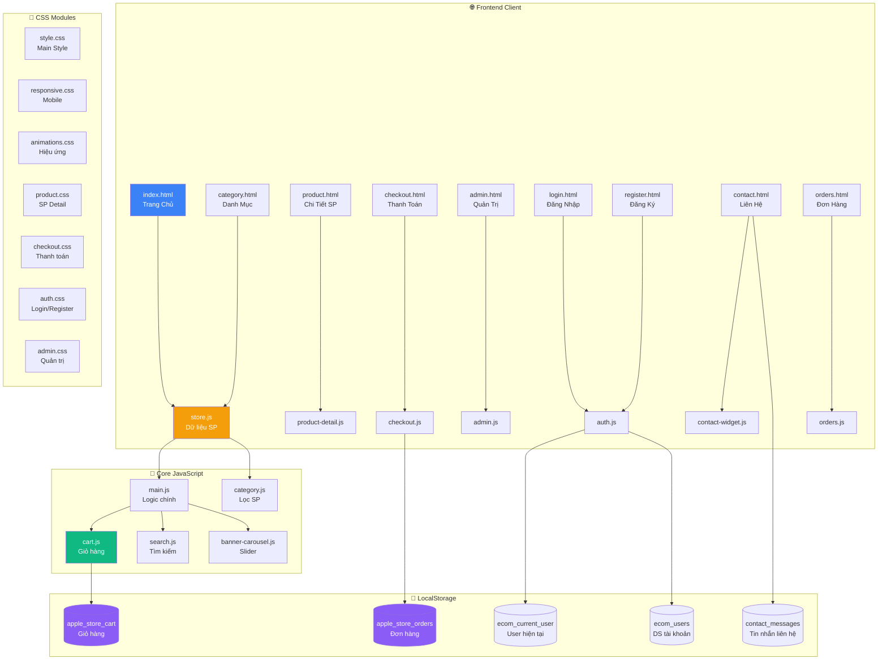
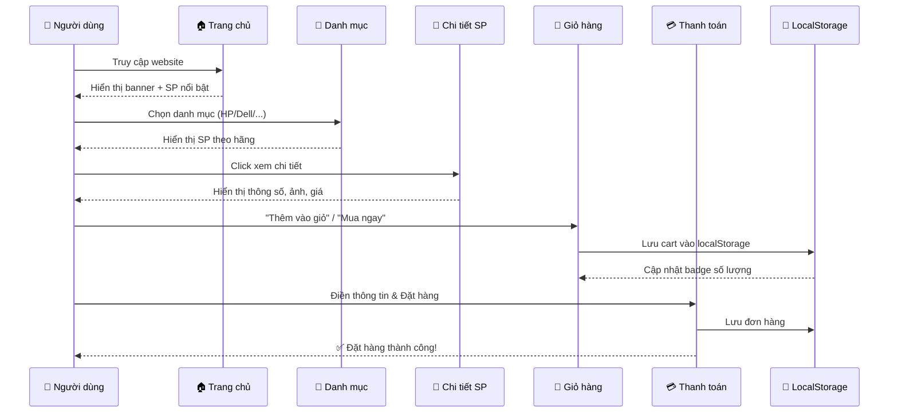

<div align="center">

# 💻 TECH WORLD — Premium Laptop Store

### *Cửa Hàng Laptop Chính Hãng Hàng Đầu Việt Nam*

<br>


<br>

[]()
[]()
[]()
[]()
[]()

---

> 🏆 **Tech World** — Website thương mại điện tử chuyên cung cấp laptop chính hãng với trải nghiệm mua sắm hiện đại, tinh tế và chuyên nghiệp. Từ laptop phổ thông đến gaming cao cấp, đáp ứng mọi nhu cầu.

<br>

[🌐 Xem Website](#-demo) · [🚀 Bắt Đầu](#-cài-đặt-và-chạy) · [📖 Tài Liệu](#-kiến-trúc-hệ-thống) · [🤝 Đóng Góp](#-đóng-góp)

</div>

---

## 📑 Mục Lục

<details>
<summary><b>📋 Nhấn để mở</b></summary>

- [✨ Tính Năng Nổi Bật](#-tính-năng-nổi-bật)
- [🖼️ Giao Diện](#️-giao-diện-website)
- [🛍️ Danh Mục Sản Phẩm](#️-danh-mục-sản-phẩm)
- [🏗️ Kiến Trúc Hệ Thống](#️-kiến-trúc-hệ-thống)
- [📂 Cấu Trúc Dự Án](#-cấu-trúc-dự-án)
- [⚙️ Cài Đặt Và Chạy](#️-cài-đặt-và-chạy)
- [🔐 Hệ Thống Xác Thực](#-hệ-thống-xác-thực)
- [🛒 Hệ Thống Giỏ Hàng](#-hệ-thống-giỏ-hàng)
- [📊 Trang Quản Trị](#-trang-quản-trị-admin)
- [📱 Responsive Design](#-responsive-design)
- [🎨 Thiết Kế & UI/UX](#-thiết-kế--uiux)
- [🔧 Công Nghệ Sử Dụng](#-công-nghệ-sử-dụng)
- [🤝 Đóng Góp](#-đóng-góp)
- [📞 Liên Hệ](#-liên-hệ)
- [📄 License](#-license)

</details>

---

## ✨ Tính Năng Nổi Bật

<table>
<tr>
<td width="50%">

### 🛍️ Mua Sắm Thông Minh
- 🔍 **Tìm kiếm nhanh** — Tìm laptop theo tên, hãng
- 📂 **Phân loại thông minh** — 4 danh mục: HP, Dell, Lenovo, MacBook
- ⭐ **Sản phẩm nổi bật** — Curated featured products
- 🏷️ **Trả góp 0%** — Hỗ trợ trả góp trên mọi sản phẩm
- 🎨 **Tùy chọn màu sắc** — Color swatches cho từng sản phẩm

</td>
<td width="50%">

### 🛒 Giỏ Hàng Hiện Đại
- ➕ **Thêm/Xóa/Sửa** — Quản lý số lượng linh hoạt
- 🔄 **Auto-sync** — Đồng bộ giỏ hàng đa tab (cross-tab)
- 💾 **Lưu trữ bền vững** — Giỏ hàng không mất khi reload
- 🔔 **Thông báo tức thời** — Toast notifications khi thao tác
- 📱 **Badge cập nhật real-time** — Hiển thị số lượng chính xác

</td>
</tr>
<tr>
<td width="50%">

### 🔐 Hệ Thống Tài Khoản
- 📝 **Đăng ký** — Tạo tài khoản nhanh chóng
- 🔑 **Đăng nhập** — Xác thực người dùng
- 👤 **Quản lý profile** — Thông tin cá nhân
- 📦 **Lịch sử đơn hàng** — Theo dõi đơn đã mua
- 🔒 **Bảo mật** — Mã hóa và lưu trữ an toàn

</td>
<td width="50%">

### 📱 Liên Hệ Đa Kênh
- 💬 **Zalo** — Chat trực tiếp qua Zalo
- 📘 **Messenger** — Nhắn tin qua Facebook
- 📞 **Hotline** — Gọi điện trực tiếp
- 📧 **Email** — Gửi thư liên hệ
- 📋 **Form liên hệ** — Gửi yêu cầu trực tiếp

</td>
</tr>
</table>

---

## 🖼️ Giao Diện Website

### 🏠 Trang Chủ (Homepage)

```
╔══════════════════════════════════════════════════════════════╗
║  🔷 TECH WORLD          [Laptop ▾] [Đơn hàng] [Liên hệ]   ║
║                         [🔍 Tìm kiếm...]      [🛒 3] [👤]  ║
╠══════════════════════════════════════════════════════════════╣
║                                                              ║
║           ┌──────────────────────────────────────┐           ║
║           │     🖼️  BANNER SLIDESHOW (Auto)       │           ║
║           │     ● ○ ○ ○  Navigation Dots          │           ║
║           └──────────────────────────────────────┘           ║
║                                                              ║
║  ┌─────────── MUA THEO DANH MỤC ───────────┐               ║
║  │ [HP]  [Dell]  [Lenovo]  [MacBook]        │               ║
║  └──────────────────────────────────────────┘               ║
║                                                              ║
║  ┌─────────── SẢN PHẨM NỔI BẬT ────────────┐               ║
║  │ ┌────┐  ┌────┐  ┌────┐  ┌────┐          │               ║
║  │ │ 💻 │  │ 💻 │  │ 💻 │  │ 💻 │          │               ║
║  │ │Dell│  │Lnvo│  │Lnvo│  │ MB │          │               ║
║  │ │ ★★ │  │ ★★ │  │ ★★ │  │ ★★ │          │               ║
║  │ └────┘  └────┘  └────┘  └────┘          │               ║
║  └──────────────────────────────────────────┘               ║
║                                                              ║
║  🏛️ GIỚI THIỆU | 🏭 THƯƠNG HIỆU | 🛠️ DỊCH VỤ              ║
║                                                              ║
╠══════════════════════════════════════════════════════════════╣
║  📞 0966457974 | ✉️ vyphan21222005@gmail.com                  ║
║  📍 285 Cách Mạng Tháng Tám, Q.10, TP.HCM                  ║
╚══════════════════════════════════════════════════════════════╝
```

### 📄 Các Trang Chính

| Trang | Mô Tả | Tính Năng |
|:---:|:---|:---|
| 🏠 **Trang Chủ** | Landing page chính | Banner slider, danh mục, sản phẩm nổi bật, giới thiệu |
| 📂 **Danh Mục** | Xem sản phẩm theo hãng | Lọc HP/Dell/Lenovo/MacBook, grid layout |
| 🔎 **Chi Tiết SP** | Thông tin chi tiết sản phẩm | Ảnh gallery, specs, chọn màu, mua ngay |
| 🛒 **Thanh Toán** | Quy trình checkout | Form thông tin, tóm tắt đơn, xác nhận |
| ✅ **Đặt Hàng Thành Công** | Trang xác nhận | Thông báo thành công, mã đơn hàng |
| 📦 **Đơn Hàng** | Lịch sử mua hàng | Danh sách đơn, chi tiết, trạng thái |
| ℹ️ **Giới Thiệu** | Thông tin công ty | Lịch sử, dịch vụ, cam kết |
| 📞 **Liên Hệ** | Thông tin liên lạc | Form liên hệ, Zalo, Messenger, Hotline |
| 🔑 **Đăng Nhập** | Xác thực người dùng | Login form, chuyển hướng |
| 📝 **Đăng Ký** | Tạo tài khoản mới | Registration form, validation |
| ⚙️ **Admin** | Trang quản trị | Dashboard, quản lý đơn hàng |

---

## 🛍️ Danh Mục Sản Phẩm

<div align="center">

### 🏪 12 Sản Phẩm Laptop Chính Hãng — 4 Thương Hiệu Hàng Đầu

</div>

<br>

<table align="center">
<tr>
<th align="center" width="25%">🔵 HP</th>
<th align="center" width="25%">🔴 Dell</th>
<th align="center" width="25%">🟢 Lenovo</th>
<th align="center" width="25%">⚪ MacBook</th>
</tr>
<tr>
<td>

**HP 14**
- 💰 16.490.000đ
- 📐 14" Display
- ⚡ Intel
- ⭐ 4.8/5.0

</td>
<td>

**Dell Inspiron 15 5430**
- 💰 17.290.000đ
- 📐 15" Display
- ⚡ Intel
- ⭐ 4.7/5.0
- 🌟 *Featured*

</td>
<td>

**Lenovo ThinkPad**
- 💰 13.990.000đ
- 📐 14" Display
- ⚡ AMD Ryzen
- ⭐ 4.6/5.0
- 🌟 *Featured*

</td>
<td>

**MacBook Air M5 15"**
- 💰 39.990.000đ
- 📐 15.3" Display
- ⚡ Apple M5
- ⭐ 4.8/5.0
- 🌟 *Featured*

</td>
</tr>
<tr>
<td>

**HP 15**
- 💰 24.500.000đ
- 📐 15.6" Display
- ⚡ Intel
- ⭐ 4.9/5.0

</td>
<td>

**Dell Inspiron 16 3520**
- 💰 12.490.000đ
- 📐 16" Display
- ⚡ Intel
- ⭐ 4.5/5.0

</td>
<td>

**Lenovo ThinkBook**
- 💰 26.490.000đ
- 📐 14" Display
- ⚡ Intel Core
- ⭐ 4.9/5.0

</td>
<td>

**MacBook Air M4 13"**
- 💰 31.990.000đ
- 📐 13.6" Display
- ⚡ Apple M4
- ⭐ 4.7/5.0
- 🌟 *Featured*

</td>
</tr>
<tr>
<td>

**HP ProBook**
- 💰 18.990.000đ
- 📐 14" Display
- ⚡ Intel Pro
- ⭐ 4.7/5.0

</td>
<td>

**Dell 16 Plus 3250**
- 💰 45.990.000đ
- 📐 16" Display
- ⚡ Intel
- ⭐ 5.0/5.0

</td>
<td>

**Lenovo V14**
- 💰 32.990.000đ
- 📐 14" Display
- ⚡ RTX 4060
- ⭐ 4.8/5.0
- 🌟 *Featured*

</td>
<td>

**MacBook Air M2 13"**
- 💰 27.990.000đ
- 📐 13.6" Display
- ⚡ Apple M2
- ⭐ 4.6/5.0

</td>
</tr>
</table>

<div align="center">

| Thống Kê | Giá Trị |
|:---:|:---:|
| 💰 **Giá thấp nhất** | 12.490.000đ (Dell Inspiron 16) |
| 💎 **Giá cao nhất** | 45.990.000đ (Dell 16 Plus) |
| ⭐ **Đánh giá trung bình** | 4.75 / 5.0 |
| 🌟 **Sản phẩm nổi bật** | 6 / 12 sản phẩm |
| 🏷️ **Trả góp** | 0% tất cả sản phẩm |

</div>

---

## 🏗️ Kiến Trúc Hệ Thống



### 🔄 Luồng Hoạt Động Chính



---

## 📂 Cấu Trúc Dự Án

```
📦 LTW_Website_Laptop/
│
├── 📁 LTWeb_Website_Laptop/
│   └── 📁 Horse_Laptop/
│       └── 📁 Horse_Laptop/
│           │
│           ├── 📁 html/                      # 🌐 Các trang HTML
│           │   ├── 📄 index.html             # Trang chủ chính
│           │   ├── 📄 category.html          # Trang danh mục sản phẩm
│           │   ├── 📄 product.html           # Trang chi tiết sản phẩm
│           │   ├── 📄 checkout.html          # Trang thanh toán
│           │   ├── 📄 order-success.html     # Trang đặt hàng thành công
│           │   ├── 📄 orders.html            # Lịch sử đơn hàng
│           │   ├── 📄 about.html             # Giới thiệu công ty
│           │   ├── 📄 contact.html           # Trang liên hệ
│           │   ├── 📄 login.html             # Đăng nhập
│           │   ├── 📄 register.html          # Đăng ký
│           │   ├── 📄 admin.html             # Trang quản trị
│           │   ├── 📄 hotline.html           # Thông tin hotline
│           │   ├── 📄 messenger.html         # Liên hệ Messenger
│           │   └── 📄 zalo.html              # Liên hệ Zalo
│           │
│           ├── 📁 css/                       # 🎨 Stylesheets
│           │   ├── 🎨 style.css              # Style chính (39KB)
│           │   ├── 🎨 responsive.css         # Responsive design
│           │   ├── 🎨 animations.css         # Hiệu ứng chuyển động
│           │   ├── 🎨 product.css            # Style trang SP
│           │   ├── 🎨 checkout.css           # Style thanh toán
│           │   ├── 🎨 auth.css               # Style đăng nhập/ký
│           │   └── 🎨 admin.css              # Style trang admin
│           │
│           ├── 📁 js/                        # ⚡ JavaScript
│           │   ├── 🟡 store.js               # Dữ liệu SP & helpers
│           │   ├── 🟡 main.js                # Logic chính
│           │   ├── 🟡 cart.js                # Hệ thống giỏ hàng
│           │   ├── 🟡 product.js             # Dữ liệu chi tiết SP
│           │   ├── 🟡 product-detail.js      # Logic trang SP
│           │   ├── 🟡 category.js            # Lọc danh mục
│           │   ├── 🟡 checkout.js            # Logic thanh toán
│           │   ├── 🟡 auth.js                # Xác thực người dùng
│           │   ├── 🟡 admin.js               # Logic quản trị
│           │   ├── 🟡 orders.js              # Logic đơn hàng
│           │   ├── 🟡 search.js              # Tìm kiếm sản phẩm
│           │   ├── 🟡 banner-carousel.js     # Banner slideshow
│           │   └── 🟡 contact-widget.js      # Widget liên hệ
│           │
│           └── 📁 images/                    # 🖼️ Hình ảnh (91 files)
│               ├── 🖼️ logo.jpg / logo-th.jpg # Logo website
│               ├── 🖼️ favicon.png            # Favicon
│               ├── 🖼️ banner*.jpg/png        # Banner slideshow
│               ├── 🖼️ hp-*.webp              # Ảnh SP HP
│               ├── 🖼️ dell-*.webp            # Ảnh SP Dell
│               ├── 🖼️ lenovo-*.webp          # Ảnh SP Lenovo
│               ├── 🖼️ macbook_*.webp         # Ảnh SP MacBook
│               └── 🖼️ zalo.png / mess.png    # Icon liên hệ
│
└── 📄 README.md                              # 📖 File này
```

---

## ⚙️ Cài Đặt Và Chạy

### 📋 Yêu Cầu

| Yêu Cầu | Chi Tiết |
|:---|:---|
| 🌐 Trình duyệt | Chrome 80+, Firefox 75+, Safari 13+, Edge 80+ |
| 📦 Server | Bất kỳ HTTP server (Live Server, XAMPP, etc.) |
| 💻 Hệ điều hành | Windows, macOS, Linux |

### 🚀 Cách Chạy

**Cách 1: Sử dụng VS Code + Live Server (Khuyến nghị)**

```bash
# 1. Clone repository
git clone https://github.com/ThuyVy211205/Website_Sell_Laptop.git

# 2. Mở trong VS Code
cd Website_Sell_Laptop
code .

# 3. Cài extension Live Server
#    → Extensions → Tìm "Live Server" → Install

# 4. Mở file html/index.html
#    → Click "Go Live" ở góc dưới bên phải
```

**Cách 2: Mở trực tiếp trong trình duyệt**

```bash
# Mở file index.html bằng trình duyệt
start LTWeb_Website_Laptop/Horse_Laptop/Horse_Laptop/html/index.html
```

**Cách 3: Sử dụng Python HTTP Server**

```bash
# Di chuyển đến thư mục chứa html
cd LTWeb_Website_Laptop/Horse_Laptop/Horse_Laptop

# Chạy server
python -m http.server 8080

# Mở trình duyệt → http://localhost:8080/html/index.html
```

> [!TIP]
> **Khuyến nghị:** Sử dụng VS Code + Live Server để có trải nghiệm phát triển tốt nhất với hot-reload.

---

## 🔐 Hệ Thống Xác Thực

```
┌──────────────────────────────────────────────────┐
│                  AUTH SYSTEM                      │
│                                                   │
│   📝 Đăng Ký ───→ Lưu vào ecom_users            │
│                    (localStorage)                 │
│                         │                         │
│                         ▼                         │
│   🔑 Đăng Nhập ──→ Verify từ ecom_users          │
│                    ──→ Set ecom_current_user      │
│                         │                         │
│                         ▼                         │
│   👤 Profile ────→ Hiển thị tên, avatar           │
│                    ──→ Nút Đăng xuất              │
│                         │                         │
│                         ▼                         │
│   🚪 Đăng Xuất ──→ Clear ecom_current_user       │
│                    ──→ Redirect về Login           │
└──────────────────────────────────────────────────┘
```

| Key localStorage | Mô Tả | Cấu Trúc Dữ Liệu |
|:---|:---|:---|
| `ecom_users` | Danh sách tài khoản | `[{email, password, name, ...}]` |
| `ecom_current_user` | User đang đăng nhập | `{email, name}` |

---

## 🛒 Hệ Thống Giỏ Hàng

### Luồng Hoạt Động

```
   ╔═══════════════════════════════════════════════════╗
   ║                 CART SYSTEM                        ║
   ╠═══════════════════════════════════════════════════╣
   ║                                                    ║
   ║  1️⃣ THÊM SẢN PHẨM                                ║
   ║     ├─ Từ Trang Chủ: nút "Thêm vào giỏ"          ║
   ║     ├─ Từ Danh Mục:  nút "Thêm vào giỏ"          ║
   ║     └─ Từ Chi Tiết:  nút "Mua ngay"               ║
   ║              │                                     ║
   ║              ▼                                     ║
   ║  2️⃣ CẬP NHẬT BADGE (Real-time)                    ║
   ║     ├─ #cartBadge (Header)                         ║
   ║     └─ #cart-count (Nav button)                    ║
   ║              │                                     ║
   ║              ▼                                     ║
   ║  3️⃣ CART MODAL                                     ║
   ║     ├─ Hiển thị danh sách SP                       ║
   ║     ├─ Tăng/Giảm số lượng                          ║
   ║     ├─ Xóa sản phẩm                               ║
   ║     └─ Tính tổng tự động                           ║
   ║              │                                     ║
   ║              ▼                                     ║
   ║  4️⃣ THANH TOÁN (checkout.html)                     ║
   ║     ├─ Điền thông tin giao hàng                    ║
   ║     ├─ Xem tóm tắt đơn hàng                       ║
   ║     └─ Đặt hàng → order-success.html               ║
   ║                                                    ║
   ╚═══════════════════════════════════════════════════╝
```

### Tính Năng Đặc Biệt

| Tính Năng | Mô Tả |
|:---|:---|
| 🔄 **Cross-Tab Sync** | Giỏ hàng đồng bộ khi mở nhiều tab |
| 💾 **Persistent Storage** | Dữ liệu giữ nguyên khi refresh |
| ⚡ **Instant Update** | Badge cập nhật ngay khi thêm SP |
| 🔔 **Toast Notification** | Thông báo mọi thao tác |

---

## 📊 Trang Quản Trị (Admin)

Truy cập: `admin.html`

### Tính Năng Admin

```
┌────────────────────────────────────────────────┐
│  ⚙️ ADMIN DASHBOARD                             │
│                                                  │
│  📊 Bảng Điều Khiển                             │
│  ├── Tổng doanh thu                              │
│  ├── Số đơn hàng                                 │
│  └── Thống kê nhanh                              │
│                                                  │
│  🛒 Quản Lý Đơn Hàng                            │
│  ├── Danh sách đơn hàng                          │
│  ├── Chi tiết đơn (viewOrderDetail)              │
│  ├── Trạng thái đơn                              │
│  └── Auto-reload khi focus tab                   │
│                                                  │
│  📨 Tin Nhắn Liên Hệ                            │
│  └── Xem tin nhắn từ khách hàng                  │
└────────────────────────────────────────────────┘
```

---

## 📱 Responsive Design

Website hoàn toàn responsive trên mọi kích thước màn hình:

```
📱 Mobile         📱 Tablet         💻 Desktop
(< 600px)         (600-1024px)      (> 1024px)
┌──────┐          ┌─────────┐       ┌───────────────┐
│ ☰ 🛒 │          │ Nav  🛒  │       │ Full Nav  🛒 👤│
├──────┤          ├─────────┤       ├───────────────┤
│Banner│          │ Banner  │       │   Banner      │
├──────┤          ├────┬────┤       ├──┬──┬──┬──────┤
│ [SP] │          │[SP]│[SP]│       │SP│SP│SP│ SP   │
│ [SP] │          │[SP]│[SP]│       │SP│SP│SP│ SP   │
│ [SP] │          │    │    │       │  │  │  │      │
├──────┤          ├────┴────┤       ├──┴──┴──┴──────┤
│Footer│          │ Footer  │       │    Footer     │
└──────┘          └─────────┘       └───────────────┘

• Menu hamburger    • Grid 2 cột     • Grid 4 cột
• Stack dọc         • Touch-ready    • Full navigation
• Full width cards  • Compact nav    • Hover effects
```

**Breakpoints chính:**

| Breakpoint | Target | Layout |
|:---:|:---|:---|
| `< 480px` | Smartphone nhỏ | 1 cột, hamburger menu |
| `480px – 768px` | Smartphone lớn | 1-2 cột, compact |
| `768px – 1024px` | Tablet | 2-3 cột |
| `> 1024px` | Desktop | 4 cột, full layout |

---

## 🎨 Thiết Kế & UI/UX

### 🎨 Design System

| Thành Phần | Chi Tiết |
|:---|:---|
| **Font chữ** | `Inter` (Google Fonts) — 400, 500, 600, 700 |
| **Color Primary** | `#7c3aed` (Purple) / `#3b82f6` (Blue) |
| **Color Accent** | `#10b981` (Emerald) / `#f59e0b` (Amber) |
| **Background** | Gradient animé (`gradientShift 15s ease infinite`) |
| **Border Radius** | 8px → 28px (rounded design) |
| **Shadow** | Layered shadows (`0 8px 40px rgba(...)`) |

### ✨ Hiệu Ứng & Animation

- 🌊 **Gradient Shift** — Background chuyển màu liên tục (15s cycle)
- 📦 **Fade-In-Up** — Sản phẩm xuất hiện từ dưới lên
- 🔄 **Banner Auto-Slide** — Carousel tự động chuyển banner
- 🎯 **Hover Effects** — Scale, shadow, color transition
- 🔔 **Toast Slide-In** — Notification trượt vào từ phải
- 💫 **Glassmorphism** — Hiệu ứng kính mờ trên card liên hệ
- 🎪 **Radial Gradients** — Decorative background overlays

### 🌈 Color Palette

```
Primary Colors:
██████  #7c3aed  (Violet)
██████  #3b82f6  (Blue)
██████  #10b981  (Emerald)
██████  #f59e0b  (Amber)

Neutral Colors:
██████  #1a1a2e  (Dark)
██████  #f3f4f6  (Light Gray)
██████  #ffffff  (White)

Accent Colors:
██████  #f97316  (Orange)
██████  #fb7185  (Pink)
██████  #ef4444  (Red)
██████  #1d4ed8  (Deep Blue)
```

---

## 🔧 Công Nghệ Sử Dụng

<table>
<tr>
<td align="center" width="20%">
<br>

<br><br>
<b>HTML5</b>
<br>
Semantic markup
<br>
SEO-friendly
<br><br>
</td>
<td align="center" width="20%">
<br>

<br><br>
<b>CSS3</b>
<br>
Flexbox, Grid
<br>
Animations
<br><br>
</td>
<td align="center" width="20%">
<br>

<br><br>
<b>JavaScript ES6+</b>
<br>
Vanilla JS
<br>
DOM API
<br><br>
</td>
<td align="center" width="20%">
<br>

<br><br>
<b>Web Storage</b>
<br>
localStorage
<br>
JSON data
<br><br>
</td>
<td align="center" width="20%">
<br>

<br><br>
<b>Google Fonts</b>
<br>
Inter typeface
<br>
Multi-weight
<br><br>
</td>
</tr>
</table>

### Không Phụ Thuộc Framework

> 🎯 **100% Vanilla** — Dự án không sử dụng bất kỳ framework JS nào (React, Vue, Angular...) hay CSS framework (Bootstrap, Tailwind...). Toàn bộ code được viết thuần từ đầu để tối ưu hiệu năng và dễ bảo trì.

---

## 📊 Bảng Thống Kê Dự Án

<div align="center">

| Metric | Giá Trị |
|:---:|:---:|
| 📄 **Tổng trang HTML** | 14 trang |
| 🎨 **File CSS** | 7 files (~75KB) |
| ⚡ **File JavaScript** | 13 files (~116KB) |
| 🖼️ **Hình ảnh** | 91 assets |
| 🛍️ **Sản phẩm** | 12 laptops |
| 🏷️ **Thương hiệu** | 4 brands |
| 💾 **LocalStorage Keys** | 5 data stores |
| 📱 **Responsive Breakpoints** | 4 levels |

</div>

---

## 🤝 Đóng Góp

Chúng tôi luôn chào đón mọi đóng góp từ cộng đồng!

```bash
# 1. Fork repository
# 2. Tạo branch mới
git checkout -b feature/amazing-feature

# 3. Commit changes
git commit -m "✨ feat: Add amazing feature"

# 4. Push to branch
git push origin feature/amazing-feature

# 5. Tạo Pull Request
```

### Commit Convention

| Prefix | Mô Tả |
|:---|:---|
| `✨ feat:` | Tính năng mới |
| `🐛 fix:` | Sửa lỗi |
| `🎨 style:` | Thay đổi UI/CSS |
| `📝 docs:` | Cập nhật tài liệu |
| `♻️ refactor:` | Tái cấu trúc code |
| `🚀 perf:` | Cải thiện hiệu năng |

---

## 📞 Liên Hệ

<div align="center">

### 🏢 Tech World — Cửa Hàng Laptop Chính Hãng

<br>

| Kênh | Thông Tin |
|:---:|:---|
| 📞 **Hotline** | `0868 264 437` |
| 📧 **Email** | `anle64437@gmail.com` |
| 📍 **Địa chỉ** | 346 bình lợi, bình lợi trung, TP.HCM |
| 💬 **Zalo** | Liên hệ trực tiếp |
| 📘 **Messenger** | Nhắn tin Facebook |

<br>

### 👩‍💻 Phát Triển Bởi

**Lê Phú An** — *Full-Stack Developer*

</div>

---

## 📄 License

<div align="center">

Dự án được phân phối dưới giấy phép **MIT License**.

Xem file [LICENSE](LICENSE) để biết thêm chi tiết.

<br>

---

<br>

**⭐ Nếu dự án hữu ích, hãy cho một Star để ủng hộ nhé!**

<br>


<br>

*© 2026 Tech World. All Rights Reserved.*

</div>
